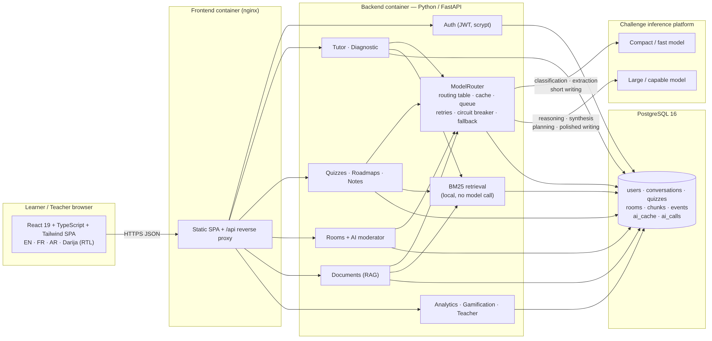
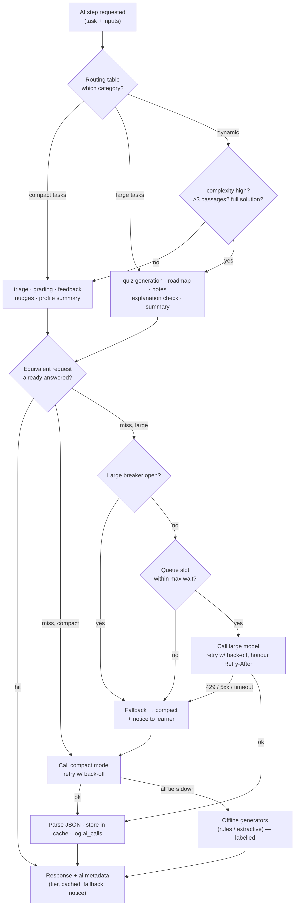

# EdNova AI — GenAI Peer-Learning Companion

> Submission for the **EdNova Technical Challenge — IEEE WIE ACT 5.0 (ENICarthage Student Branch)**.
> An intelligent peer-learning companion that acts as *tutor, teammate, mediator and facilitator*:
> it explains, hints before answering, detects confusion, personalises to each learner's style and
> language (English, French, Arabic, Tunisian Darija), moderates study rooms for equal participation,
> grounds answers in uploaded course material (RAG), generates and corrects quizzes, and builds
> roadmaps and revision notes — while combining the platform's **two model categories deliberately**.



---

## Contents

1. [Features](#features)
2. [Two-model architecture (the core design)](#two-model-architecture)
3. [Quick start](#quick-start)
4. [Configuration template](#configuration-template)
5. [Project structure](#project-structure)
6. [API](#api)
7. [Testing](#testing)
8. [Privacy & ethics](#privacy--ethics)
9. [Known limitations & honest status](#known-limitations--honest-status)
10. [Documentation index](#documentation-index)

---

## Features

| Area | What EdNova does | Model category |
|---|---|---|
| **AI personal tutor** | Explains simply, **hints before answers** (3 hint levels, "reveal" on demand), asks a guiding question, suggests the next step, **detects confusion** and slows down | triage: compact · answer: compact *or* large (dynamic) |
| **Diagnostic & personalisation** | 6 preference questions + 3 micro-exercises → learning style (visual, analogy, step-by-step, examples, repetition, problem-solving) + level; every prompt adapts to it | scoring: none · summary: compact |
| **Quizzes with auto-correction** | MCQ + short-answer quizzes from a topic or a document; MCQs graded locally, short answers graded in **one batched call**, personalised feedback, skill tags → mastery tracking | generate: large · grade/feedback: compact |
| **Collaborative rooms + AI moderator** | Rooms by code, polling chat, **participation-balance score**, automatic nudges to quiet members, Socratic guiding questions, **"check this explanation"** fact-check, session summary, collaborative quiz + leaderboard, `@ednova` questions | nudge/question: compact · check/summary: large |
| **Documents & RAG** | PDF / DOCX / TXT / MD upload → sentence-aware chunks → **BM25 retrieval** (AR/FR/EN tokenizer) → cited answers `[1]`; quizzes, notes and roadmaps grounded in the document | retrieval: none · answer: dynamic |
| **Roadmaps & revision notes** | Week-by-week plan with checkable activities adapted to style; notes + flashcards from a conversation, a document, a room or a topic; download as Markdown | large |
| **Analytics & gamification** | XP, levels, streaks, 10 badges, 14-day activity, skill mastery & trends, confusion hotspots, rule-based "next step", **AI-efficiency panel** (compact/large split, cache hits, fallbacks) | none |
| **Teacher dashboard** | Class codes, anonymised aggregates: style distribution, weak skills, confusion hotspots, participation balance | none |
| **Multilingual** | Full UI + AI responses in **EN / FR / AR / Tunisian Darija** (Arabic or Latin script), RTL layout | — |
| **Resilience** | Staged progress UI, response cache, bounded queue, retries with back-off, circuit breaker, large→compact→offline fallback with explicit notices | — |

---

## Two-model architecture

The platform offers a *compact/fast* and a *large/capable* model category. EdNova's **ModelRouter**
(`backend/app/ai/router.py`) applies a documented routing table (`backend/app/ai/tasks.py`, also served
at `GET /api/system/routing`):

| Task | Category | Why |
|---|---|---|
| `tutor_triage` (language, intent, confusion, complexity) | **compact** | pure classification; its result decides whether the large model is needed at all |
| `tutor_answer` | **dynamic** | compact for definitions / simple clarifications / ≤2 passages; large for multi-step reasoning, full worked solutions (hint level 3) or ≥3-passage synthesis |
| `diagnostic_summary`, `quiz_feedback`, `quiz_grade_short` (batched), `room_nudge`, `room_guiding_question` | **compact** | short writing / bounded judgement from structured inputs computed in code |
| `quiz_generate`, `roadmap_generate`, `notes_generate`, `room_summary`, `room_check_explanation` | **large** | reasoning, planning, multi-source synthesis, polished writing, correctness verification |
| `rag_answer` | **dynamic** | compact when one high-scoring passage answers a short question, large otherwise |
| retrieval, MCQ grading, participation stats, diagnostic scoring, next-step rules, cache | **no model** | computed locally |



**Efficient use of a shared, limited service**

* **Cache** — equivalent requests (same task, category and *normalised* inputs) are served from an
  in-memory LRU + persistent `ai_cache` table instead of being regenerated.
* **Fewer, well-built requests** — a tutor turn costs at most 2 calls (triage + answer); a quiz
  submission costs at most 2 calls regardless of the number of questions (one batched grading call +
  one feedback call); MCQs cost 0.
* **Queue** — large-model calls go through a bounded semaphore (`AI_LARGE_CONCURRENCY`); the queue depth
  is exposed to the UI; waiting beyond `AI_LARGE_QUEUE_WAIT_S` falls back to the compact model.
* **Retries** — exponential back-off on 429/5xx/timeouts, honouring `Retry-After`.
* **Circuit breaker** — repeated large-model failures open the breaker; requests are routed straight to
  the compact model until it closes.
* **Graceful degradation** — large → compact → *offline generators* (rules/extractive). Every response
  carries `ai` metadata (`tier`, `cached`, `fallback`, `fallback_reason`, `notice`) and the UI shows a
  banner/pill so the learner always knows what happened. Nothing fails silently.
* **Latency as a design budget** — responses arrive as a whole; the UI shows staged progress
  (*understanding → searching documents → thinking → formatting*) with typical durations.

---

## Quick start

### Option A — Docker (PostgreSQL + backend + frontend)

```bash
cp .env.example .env            # fill AI_BASE_URL / AI_API_KEY / model names (or leave empty for offline demo mode)
docker compose up --build
# frontend: http://localhost:8080   backend API: http://localhost:8000/api/health
```

Seed synthetic demo data (3 learners + 1 teacher, room, document, quiz, roadmap, notes):

```bash
docker compose exec backend python scripts/seed_demo.py --base http://127.0.0.1:8000
# accounts: amal@demo.ednova · lina@demo.ednova · sami@demo.ednova · prof@demo.ednova — password Demo-Pass-2026
```

### Option B — local development (SQLite, no Docker)

```bash
# backend
cd backend
python -m venv .venv && source .venv/bin/activate
pip install -r requirements.txt
cp ../.env.example ../.env       # set DATABASE_URL=sqlite:///./ednova.db and your AI credentials
uvicorn app.main:app --reload --port 8000

# frontend (another terminal)
cd frontend
npm install
npm run dev                      # http://localhost:5173 — proxies /api to http://127.0.0.1:8000
```

Without `AI_API_KEY`, EdNova starts in **offline demo mode**: the UI shows a banner and every AI
field is filled by clearly labelled rule-based/extractive generators, so the whole flow is demonstrable.

---

## Configuration template

See [`.env.example`](.env.example) — it contains **no credentials**. Key variables:

| Variable | Purpose |
|---|---|
| `AI_BASE_URL`, `AI_API_KEY`, `AI_API_STYLE` | Inference platform endpoint (OpenAI-compatible `/chat/completions` or Anthropic `/messages`) |
| `AI_COMPACT_MODEL`, `AI_LARGE_MODEL` | Names of the two model categories on the platform |
| `AI_LARGE_CONCURRENCY`, `AI_LARGE_QUEUE_WAIT_S` | Queue for the scarce large model |
| `AI_MAX_RETRIES`, `AI_BREAKER_*` | Retry and circuit-breaker policy |
| `AI_CACHE_TTL_S` | Cache lifetime for equivalent requests |
| `DATABASE_URL` | `postgresql://…` (Docker) or `sqlite:///./ednova.db` (local) |
| `SECRET_KEY` | JWT signing key |

Credentials must never be committed, logged, screenshotted or shown in videos (`AI_LOG_PROMPTS` is off by default).

---

## Project structure

```
ednova-ai/
├── backend/                 Python API (FastAPI conventions)
│   ├── app/
│   │   ├── main.py          app factory, CORS, routers, optional static frontend
│   │   ├── compat.py        FastAPI import indirection (see "honest status")
│   │   ├── minifastapi.py   Starlette-based compatibility layer (used only if FastAPI is absent)
│   │   ├── db.py            PostgreSQL / SQLite DB-API layer + schema
│   │   ├── security.py      scrypt password hashing, JWT
│   │   ├── schemas.py       Pydantic request models
│   │   ├── ai/              provider.py (OpenAI/Anthropic adapters) · router.py (ModelRouter)
│   │   │                    tasks.py (routing table) · prompts.py · offline.py (labelled fallbacks)
│   │   ├── rag/             extract.py · chunk.py · bm25.py · index.py
│   │   ├── services/        tutor · quiz · rooms · diagnostic · analytics · gamification · users
│   │   └── api/             auth · diagnostic · tutor · quizzes · rooms · documents · roadmaps · notes · analytics · classes · system
│   ├── scripts/seed_demo.py synthetic demo data
│   ├── tests/               pytest suite (36 tests) with a fake inference provider
│   ├── requirements.txt · Dockerfile
├── frontend/                React 19 + TypeScript + Tailwind 4 SPA (esbuild)
│   ├── src/pages · src/components · src/lib (router, api, auth, i18n, status, progress, charts)
│   ├── scripts/build.mjs · scripts/dev.mjs · nginx.conf · Dockerfile
├── docs/                    architecture, model routing, RAG, privacy, business model, testing, storyboard, checklist, screenshots
├── submission/              technical report (PDF), presentation (PPTX)
├── docker-compose.yml · .env.example
```

---

## API

Full contract in [`docs/API.md`](docs/API.md). Highlights:

* `GET /api/system/status` — provider mode, large-model availability, breaker state, queue depth, call statistics.
* `GET /api/system/routing` — the documented routing table.
* `POST /api/tutor/conversations/{id}/messages` — one tutor turn (triage → retrieve → reason → format).
* `POST /api/quizzes/generate`, `POST /api/quizzes/{id}/submit`.
* `POST /api/rooms`, `/join`, `/{id}/messages`, `/{id}/moderate` (`nudge | guiding_question | check_explanation | summarize`), `/{id}/quiz`, `/{id}/leaderboard`.
* `POST /api/documents` (multipart), `/{id}/search`, `/{id}/ask`.
* `POST /api/roadmaps`, `POST /api/notes/generate`, `GET /api/analytics/overview`, `GET /api/classes/{id}/dashboard`.

---

## Testing

```bash
cd backend && python -m pytest -q                      # 36 tests (unit + API)
cd frontend && npm run typecheck && npm run build      # 0 TypeScript errors, production bundle
cd frontend && node scripts/e2e.mjs --shots ../docs/screenshots   # 15 real browser flows (backend + dev server running)
```

The backend suite uses a **fake inference provider** to exercise the live routing paths deterministically
(tier selection, cache hits, retry-then-success, large→compact fallback with localised notice, rate-limit
reason, circuit breaker, queue-full fallback, all-tiers-down → offline) plus every feature end-to-end
through the HTTP API (auth, diagnostic, hint-first tutor flow, quiz grading, rooms & moderator,
documents & RAG, roadmaps, notes, analytics, teacher dashboard). A Playwright script then drives the real UI against
the real backend (register → diagnostic → tutor → documents → quiz → room → roadmap → notes → analytics → RTL →
teacher → mobile): **15/15 flows passed, 0 page errors**. Results and strategy: [`docs/TESTING.md`](docs/TESTING.md).

---

## Privacy & ethics

* **Data minimisation** — pseudonymous display names, email + password only; no photos, voices, addresses.
* Uploaded files are **not kept**: only extracted text chunks are stored, and documents/accounts can be
  deleted at any time (`DELETE /api/auth/me` erases everything).
* Prompts are never logged by default; only public, synthetic or anonymised data should be sent to the service.
* Prompts instruct the models to be inclusive and neutral regarding gender, region, language level or
  background, and to **support — not replace — teachers**; the teacher dashboard shows only aggregates.
* Details: [`docs/PRIVACY_ETHICS.md`](docs/PRIVACY_ETHICS.md).

---

## Known limitations & honest status

* **Build environment** — this repository was produced in a sandbox where PyPI/npm were unreachable. The
  code is written against the FastAPI API; `app/compat.py` imports the real `fastapi` when installed and
  otherwise falls back to a small Starlette compatibility layer (`app/minifastapi.py`). All automated
  tests in this repository were executed with the compatibility layer on **Starlette 1.7 + SQLite**.
  Running with the real FastAPI, with PostgreSQL via `psycopg`, and the Docker images have **not yet been
  executed** in that sandbox — please run `pip install -r requirements.txt` / `docker compose up --build`
  and report any issue.
* **No live AI credentials were available** while building: every AI path was validated with a fake
  provider; real-platform latency, JSON compliance and quality have not been measured yet. The code
  tolerates non-JSON answers (raw text is kept) and degrades explicitly.
* Retrieval is lexical (BM25). An embedding endpoint can be added behind the same `search()` interface.
* Rooms use short polling (3 s) rather than WebSockets to keep the deployment simple.
* No voice interaction yet (listed as a possible extension).

---

## Documentation index

| Document | Content |
|---|---|
| [`docs/ARCHITECTURE.md`](docs/ARCHITECTURE.md) | System, data model, request flows, diagrams |
| [`docs/MODEL_ROUTING.md`](docs/MODEL_ROUTING.md) | GenAI module: routing table, prompts, resilience, budget |
| [`docs/RAG.md`](docs/RAG.md) | Document pipeline and retrieval |
| [`docs/PRIVACY_ETHICS.md`](docs/PRIVACY_ETHICS.md) | Safeguards |
| [`docs/BUSINESS_MODEL.md`](docs/BUSINESS_MODEL.md) | Target users, value proposition, adoption path, sustainability |
| [`docs/TESTING.md`](docs/TESTING.md) | Strategy, executed results, what remains untested |
| [`docs/DEMO_VIDEO_STORYBOARD.md`](docs/DEMO_VIDEO_STORYBOARD.md) | 90-second demo video storyboard |
| [`docs/SUBMISSION_CHECKLIST.md`](docs/SUBMISSION_CHECKLIST.md) | Phase 1 / Phase 2 checklist |
| [`submission/`](submission/) | Technical report (PDF ≤ 6 pages), presentation (PPTX) |

---

*Team-owned work. Access credentials for the inference platform are personal to the team and are never
stored in this repository.*
