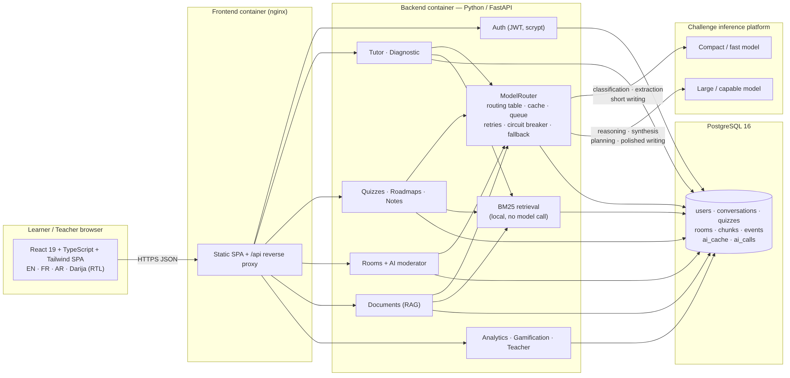
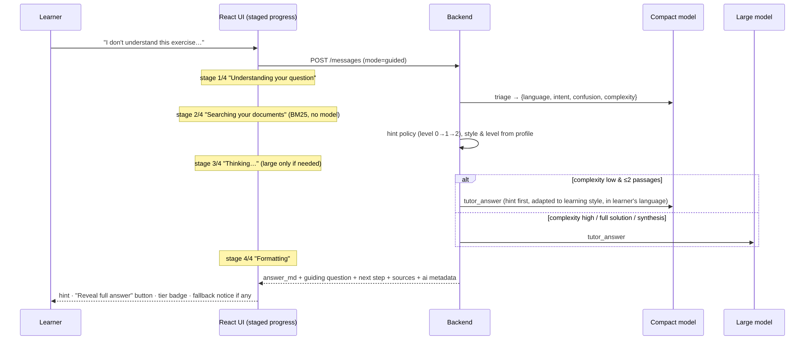

# System architecture

## Components

| Layer | Technology | Responsibility |
|---|---|---|
| Frontend | React 19, TypeScript (strict), Tailwind CSS 4, esbuild; nginx in Docker | SPA with 14 pages, i18n EN/FR/AR/Darija + RTL, staged progress, service banner, inline-SVG charts; `/api` proxy |
| Backend | Python 3.11+, FastAPI conventions (Starlette compatibility layer when FastAPI is unavailable), Pydantic v2, uvicorn | REST API, JWT auth, services, ModelRouter, RAG |
| Database | PostgreSQL 16 (Docker) / SQLite (dev, tests) via a thin DB-API layer (`app/db.py`) | 18 tables, UUID keys, ISO timestamps, JSON payloads as text |
| Inference | Challenge platform: compact + large categories, OpenAI-compatible or Anthropic wire format | all generation, selected per task by the routing table |

## Request flows

### Tutor turn (≤ 2 model calls)

1. `POST /api/tutor/conversations/{id}/messages` stores the learner message.
2. **Triage** (compact): language, intent, confusion, complexity, topic. Heuristic fallback offline.
3. **Retrieve** (no model): BM25 over the conversation's document (or the learner's 5 latest documents).
4. **Hint policy**: guided mode + exercise intent → hint level 0 → 1 → 2 (reveal). New question → 0.
5. **Reason** (compact or large per routing table): system prompt built from learning style, level,
   hint level, confusion, language/script, passages; JSON answer.
6. **Format & persist**: assistant message with metadata (ai, triage, sources, guiding question, next
   step, confusion), conversation title/hint level update, events (question_asked, confusion_detected),
   XP and badges.

### Collaborative room

* Members join by 6-character code; messages are fetched by polling with an `after` cursor (3 s).
* After every message the backend recomputes **participation balance** = normalised entropy of message
  counts (1.0 = perfectly balanced), detects a dominant member (> 50 % of messages) and quiet members
  (< 25 % of the average). Every `ROOM_MODERATOR_EVERY_N` messages, if the balance is below 0.75 or quiet
  members exist, the moderator posts a nudge (compact).
* Explicit actions: `nudge`, `guiding_question` (compact), `check_explanation`, `summarize` (large),
  collaborative quiz (large, shared via `room.quiz_id`) with leaderboard; `@ednova <question>` answers
  the group with the tutor prompt in direct mode.

### Quiz

Generation (large, cached by topic/document/difficulty/language/count/types) → public questions without
answers → submission graded: MCQ in code, short answers in **one** batched compact call (bounded by a
token-overlap heuristic), feedback (compact) → attempt stored → `quiz_completed` event with skill scores
feeding mastery analytics; collaborative quizzes feed the room leaderboard.

## Data model (main tables)

`users` · `conversations` · `messages` · `quizzes` · `quiz_attempts` · `rooms` · `room_members` ·
`room_messages` · `documents` · `chunks` · `roadmaps` · `notes` · `events` · `badges` · `ai_cache` ·
`ai_calls` · `classes` · `class_members`. Schema: `backend/app/db.py` (`CREATE TABLE IF NOT EXISTS`, portable
to PostgreSQL and SQLite). Placeholders `?` are rewritten to `%s` for psycopg.

## Security

* JWT (HS256) access tokens, 24 h; scrypt password hashing with per-user salt.
* Ownership checks on every resource; room/class access by membership; teacher-only endpoints.
* Pydantic validation (422 with field errors); upload type/size limits; CORS allow-list.
* Secrets only in environment variables; `.env.example` ships without values.

## Deployment

`docker-compose.yml`: `db` (postgres:16-alpine, health-checked volume), `backend` (python:3.12-slim,
non-root user, health-check on `/api/health`, 2 uvicorn workers), `frontend` (multi-stage node build →
nginx with SPA fallback and `/api` reverse proxy, 180 s proxy timeouts for whole-response generation).
Single-container alternative: set `SERVE_FRONTEND_DIR=/app/static` and mount the built frontend.
