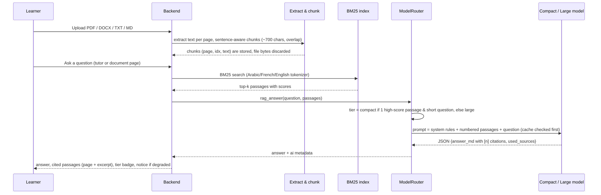

# Document retrieval (RAG) workflow

## Pipeline

1. **Upload** (`POST /api/documents`, multipart, ≤ 15 MB): PDF (`pypdf`), DOCX (`python-docx`), TXT, Markdown.
2. **Extraction** per page (`rag/extract.py`); plain-text files are split into pseudo-pages of ~3 000
   characters so that citations always carry a page number. Scanned PDFs without a text layer are rejected
   with an explicit message (no OCR dependency).
3. **Chunking** (`rag/chunk.py`): sentence-aware chunks of ~700 characters with a one-sentence overlap;
   page numbers preserved. The original file bytes are discarded — only chunks are stored (`chunks` table).
4. **Indexing** (`rag/bm25.py`, `rag/index.py`): Okapi BM25 in pure Python, built lazily per document and
   cached in memory. The tokenizer normalises Unicode, strips Arabic diacritics and the `ال` article,
   removes accents, applies light suffix stemming and a trilingual stop-word list (EN/FR/AR/Darija).
5. **Retrieval**: `search(query, k)` returns passages with scores normalised to the best hit (0–1).
   Used by: tutor turns (`use_documents`), document Q&A, quiz generation, notes, roadmaps.
6. **Generation**: the router sends *only* the top-k passages, numbered, and requires `[n]` citations.
   Category: compact when one passage with score ≥ 0.75 answers a short question, large otherwise.
7. **Display**: answer + cited passages (page, excerpt, score) + category pill + notice if degraded.

## Why BM25 (and not embeddings) for the prototype

* The platform provides no embedding endpoint and no fine-tuning; BM25 needs no model call, runs in
  milliseconds and works for Arabic, French and English alike.
* It fulfils the brief's purpose — narrowing the context handed to the model to improve relevance and
  reduce load — and keeps the system fully functional offline (extractive answers).
* The `search()` interface is provider-agnostic: a dense or hybrid retriever can be added later without
  touching the callers.

## Offline behaviour

Without a model, `offline.rag_answer` returns the sentences of the top passages that best overlap the
question (extractive QA), still with `[n]` citations and the explicit "offline" notice.
